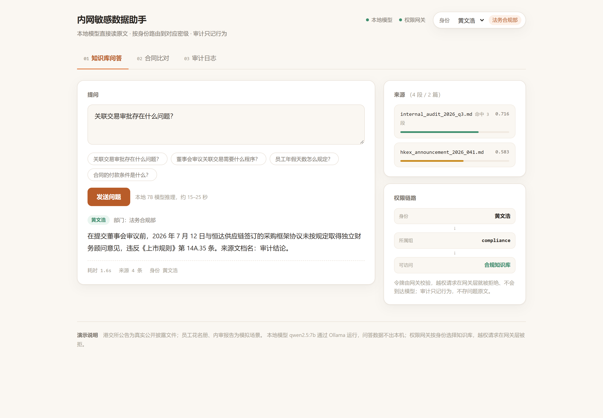
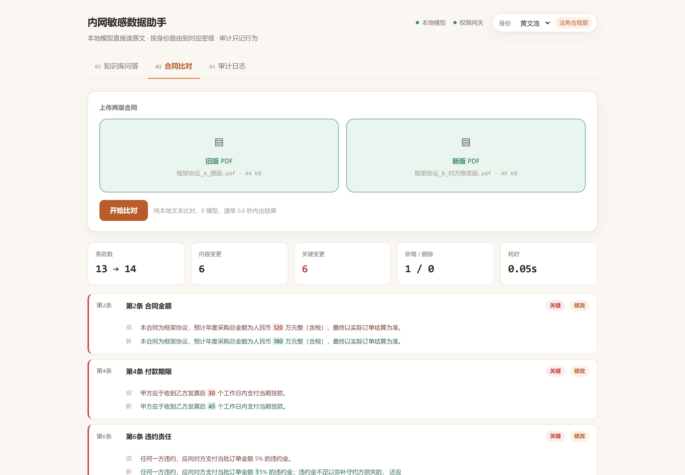

# 内网敏感数据 RAG：本地模型 + 分密级权限 + 审计

**场景**：合规专员做季度关联交易审查。港交所公告每份 80 多页，表格没有框线、扫描版用 Ctrl+F 搜不到，
人工翻一遍要几十分钟、还容易漏。这个系统让**本地模型直接读原文**，按身份路由到对应密级的知识库，
回答给出条款原文和相似度；数据不出内网，审计只记行为。



**能跑起来的六件事**（全部本机实测，不是设计稿）：

| 能力 | 实测结果 |
|---|---|
| 无框线表格解析 | 4 份真实港股公告，pdfplumber 默认识别 **0/4** → 坐标重建 + 事实句后表格问答 **20/20** |
| 分密级权限路由 | 网关按身份选知识库；越权 403、无效令牌 401，请求到不了模型 |
| 审计留痕 | 只记行为（SHA256 前 16 位），**实测发现 Dify messages 表会存原文**（见下方「审计被打穿」） |
| 合同条款级比对 | 两版 PDF → 13→14 条、6 处关键变更，**0.04 秒、0 模型** |
| 飞书接入 | 手机提问 → 回复带部门身份、条款号、来源文件与相似度（真实企业自建应用） |
| Web 界面 | 问答 / 合同比对 / 审计三个页签，权限链路可视化 |



启动界面：`python3 scripts/app.py`（默认 8092）→ 浏览器打开 <http://127.0.0.1:8092/>。
权限网关另起：`python3 scripts/gateway.py`（8090）。两个服务都在 `start-demo.bat` 里。

> **定位**：技术验证（POC），不是生产系统。没有真实客户、没有部门在用、没测过并发。
> 这个仓库的价值在于**实测数据和踩过的坑**，不在代码量。

---

## 三个实测发现（这是本仓库的主要产出）

### 1. 港股公告的表格，主流 PDF 库一个都识别不出来

从港交所下载 4 份真实公告（收购、持续关连交易、出资协议），实测：

| 公告 | 页数 | 字符数 | pdfplumber 默认识别表格 |
|---|---|---|---|
| 七色珠光收购 | 16 | 9,122 | **0 个** |
| 中铝合资 | 10 | 5,176 | **0 个** |
| 中海油服框架协议 | 16 | 11,307 | **0 个** |
| 立讯持续关连交易 | 16 | 9,496 | **0 个** |

原因：港股公告的表格**没有任何框线**（实测每页线条数 = 0），全靠空白对齐。
pdfplumber 默认按线条识别；改用 `vertical_strategy="text"` 会过度切分，把正文切成假表格
（`"香" | "港交易及結算所有限公司…"`）。

**原始文本流会把表格彻底打散**：

```
建議年度上限
673
734
804
363
429
484
```

模型看到 "673" 不知道是哪个项目、哪一年。

**解法**：用 word 的 bbox 按 y 聚行、按 x 对齐表头列，再拆成「项目｜列名｜数值」事实句。

**可复跑评测**（`scripts/table_qa_eval.py`）：4 份公告各 1 道金额题 × 三种喂法 × 固定温度 0 + 固定 seed × 每题重复 5 次：

| 喂法 | 答对 | 说明 |
|---|---|---|
| PDF 文本流（生产里实际拿到的形态，空列被吃掉） | **15/20 = 75%** | 唯一的失败点：中海油服物业服务 2026 年上限，5/5 全答成 429（= 2027 年的值），正是「缺列 ⇒ 数字与表头错位」 |
| Markdown 表格（完整保留空列） | 20/20 = 100% | 结构完整时模型能自己对齐，不需要事实句 |
| **事实句**（每格「项目｜列名｜单位 数值」） | **20/20 = 100%** | 不依赖模型数格子 |

> **口径修正（2026-10-19 实测）**：早先「Markdown 表格 3/4」的口径不准 —— 当时的输入其实是**PDF 文本流压平**（
> 空列被吃掉、数字连成一行），不是结构完整的 Markdown 表格。补齐的空列后 Markdown 也是 20/20。
> 所以真正成立的是：**错位的根因是「空列丢失导致列与数值错配」**；把列名写进每一行能消掉它，
> 而**完整保留空列的表格**也能消掉它。
>
> **口径边界**：4 题仍是小样本（只覆盖金额表），只能说明方向，不能外推成「准确率提升 X%」的普适结论。
> 复跑：`python3 scripts/table_qa_eval.py`（本地 Ollama + qwen2.5:7b，不花钱）；明细落盘 `out/table_qa_eval/`。

> 附带教训：我人工核对 PDF 表格对齐时错了两次，按坐标实测才发现脚本一直是对的。
> **这类表格不能靠"人看一眼觉得对"验收。**

### 2. 社区版 Dify 做不了库内按人隔离，只能用「分密级库 + 网关路由」

Dify 的 chat API 不能动态指定知识库，知识库绑死在应用配置里。所以权限落地方式只能是：

```
用户 → 权限网关(:8090) → 查部门 → 选对应应用 → Dify /v1/chat-messages
                       → 审计（谁/何时/走哪个库/是否拦截/耗时）
```

用户拿不到 app key，不能直连 Dify。**这比片段级过滤更硬**：越权用户请求时，检索发生在
他自己的库里，敏感文档根本不在候选集中——不是查出来再隐藏，而是从来没被检索过。

实测（同一问题「关联交易审批存在什么问题」）：

| 身份 | 路由 | 回答 | 检索来源 | 耗时 |
|---|---|---|---|---|
| 合规部 | 合规知识库 | 违反《上市规则》14A.35 条 | internal_audit 0.72 | 1.4 s |
| 人事部 | 人事知识库 | 未提及 | hr_roster 0.43 | 0.5 s |
| 访客 | — | HTTP 403 | — | 0 ms |
| 无效令牌 | — | HTTP 401 | — | 0 ms |

### 3. 「审计只存哈希」会被 Dify 自己的表打穿

网关审计只记行为（问题存 SHA256 前 16 位，不存原文），但实测发现 **Dify 的 `messages` 表
存了完整的问答原文**：

```
query = "陈大文的月薪是多少"
answer = "陈大文的月薪是128,000港元。来源文档：员工花名册（人事部专用）。"
```

处理方式不是删（泄密调查必须要原文），而是把它写进制度：**留存多久、谁能查、查要谁批准**。
对外不能宣称"系统不存原文"。

---

## 接入飞书：三个必须做对的保护

企业里真正会用起来的地方不是网页，是员工本来就在用的 IM。这一层已实现（`scripts/feishu_bridge.py`，标准库、零新依赖）：

```
员工在飞书发消息
   → 飞书事件回调 POST /feishu/event
   → 验签 + event_id 去重 + 入队   ← 只做这些，不碰模型
   → 立即返回 200（实测 31 ms）
   → 异步 worker：open_id 查部门 → 权限网关 :8090 → 密级应用
   → 主动回消息（附来源文档与相似度）
```

**必须异步的原因（实测，不是理论）**：本机新问题 12.2 s（qwen2.5:7b 完整生成），
预热过的相似问题 0.5~1.2 s。飞书回调超时会重试，用户在群里就会收到三条重复回复。

三个保护：

| 保护 | 做法 | 不做的后果 |
|---|---|---|
| 立即返回 | 回调里只验签去重入队 | 超时 → 飞书重试 → 重复回复刷屏 |
| event_id 幂等 | sqlite 主键原子抢占 | 重试被当新消息处理，模型被重复调用 |
| 身份只从 open_id 查 | 部门从通讯录查，**绝不读消息体自报字段** | 员工自己填一句「我是合规部」就绕过隔离 |
| 离职即时吊销 | 订阅 `contact.user.deleted_v3` 写吊销名单 | 人走了权限还在 |

自测（不需要飞书凭据，11 项全过）：`python scripts/feishu_bridge.py --selftest`

```
[PASS] challenge 原样回显          [PASS] 错误 token 返回 403
[PASS] 200 且 1 秒内返回  32 ms     [PASS] 异步写成 1 条回复
[PASS] 回复里带密级库名             [PASS] 重发返回 duplicate
[PASS] 没有产生第二条回复            [PASS] 访客收到无权限提示
[PASS] 离职后拒绝回答               …
```

> **现状边界**：目前只有 mock 模式跑通（读 `out/feishu_users.json` 的 open_id→部门映射，
> 回复写 `out/feishu_replies.jsonl`）。接真飞书要补 `FEISHU_APP_ID` / `FEISHU_APP_SECRET`，
> 并在飞书后台配事件订阅与 `im:message`、`contact:user.base:readonly` 权限。
> **图片与文件消息还没做**（下一阶段）。

### 接真环境：用长连接，不用公网 IP

飞书事件有两条路，内网部署只能走第二条：

| 订阅方式 | 要求 | 适用 |
|---|---|---|
| HTTP 回调（`--port 8091`） | 飞书服务器要能访问你的 URL ⇒ **必须公网 IP / 域名 / 内网穿透** | 有公网服务器时 |
| **长连接 `--ws`（推荐）** | 本地主动连飞书（出站即可），**不需要公网 IP、不需要内网穿透** | 内网/本机 |

长连接的代价与限制：只支持企业自建应用；事件仍要在 **3 秒内处理完**（超时重推，所以照样异步）；
同一应用多实例时只有一个实例会收到事件（集群模式，不广播）。

配置顺序（顺序错了保存不成功）：

```bash
# 1. 凭据放 .env（cp .env.example .env 后填 app_secret）
# 2. 先启动客户端 —— 必须在长连接在线时，飞书后台才允许保存「使用长连接接收事件」
python scripts/feishu_bridge.py --ws
# 3. 再去飞书后台：事件与回调 → 订阅方式 → 使用长连接接收事件 → 保存
#    添加事件：接收消息 im.message.receive_v1、员工离职 contact.user.deleted_v3
# 4. 权限管理 → 批量导入（JSON 格式，见下）→ 下一步
#    必需：im:message / im:message.p2p_msg:readonly / im:message.group_at_msg:readonly
#          im:message:send_as_bot / im:resource
#          contact:contact.base:readonly（调用户接口的接口级权限）
#          contact:user.base:readonly（拿姓名）
#          contact:user.department:readonly（拿 department_ids —— 权限映射靠它）
# 5. 版本管理与发布 → 创建版本 → 申请发布（自建应用不发版不生效）
# 6. 手机上给机器人发一句话，看终端是否打印 [ws] 消息 … → queued
```

权限批量导入的 JSON（贴进弹窗即可，全部是应用身份 tenant）：

```json
{
  "scopes": {
    "tenant": [
      "im:message",
      "im:message.p2p_msg:readonly",
      "im:message.group_at_msg:readonly",
      "im:message:send_as_bot",
      "im:resource",
      "contact:contact.base:readonly",
      "contact:user.base:readonly",
      "contact:user.department:readonly",
      "contact:department.base:readonly",
      "contact:user.id:readonly"
    ]
  }
}
```

> ⚠️ 坑 1：`contact:user.base:readonly` **只给 name/en_name/avatar，不含 department_ids**。
> 拿部门必须额外开 `contact:user.department:readonly`（高级权限），否则会一直报「部门未映射到任何密级」。
> ⚠️ 坑 2：批量导入框只认上面这个 JSON 结构（`{"scopes":{"tenant":[...]}}`），
> 不收逗号分隔的列表；`user` 数组是「以用户身份调用」的权限，这里不需要，可以整段省略。

导入后验证权限链（比猜有用）：

```bash
python scripts/feishu_probe.py                 # token + 部门列表 + 生成 depmap 模板
python scripts/feishu_probe.py --phone 138xxx  # 顺带验证「手机号 → department_ids」通不通
```

部门 → 密级 的映射：飞书返回的是部门 id，需要建 `out/feishu_depmap.json`：

```json
{ "od-xxxxxxxxxxxxxxxx": ["compliance"], "od-yyyyyyyyyyyyyyyy": ["hr"] }
```

> 实测补充：小租户常常**所有人都在根部门 `0`**，按部门根本分不出密级。
> 这种情况用 `out/feishu_users.json` 按 open_id 精确指定，优先级高于部门映射（改文件即时生效，不用重启）。

### 员工发图片：识别 → 判定 → 入库 → 可撤销

```
员工在飞书发一张照片
   → 下载（im:resource 权限）→ 存 out/uploads/
   → RapidOCR 本地识别（不出网）→ 抽字段（身份证号走 GB11643 校验位）
   → 回复识别结果，**默认不写库**
   → 员工自己决定：
        回「入库」        → 写进他所属密级的库（5 分钟内可「撤销」删除）
        直接问一句问题    → 按这张图的内容回答（本地模型，不走知识库）
        <0.70 置信度      → 「没认清，请靠近对准重拍」，不给入库选项
```

**为什么默认不写库**：发照片不等于要入库。同一张纸可能是「这合同有什么问题」、
可能是「帮我把金额抄出来」、也可能是私人证件根本不该进公司知识库。
判断不了意图就别替人做决定——写进知识库是会让所有人检索到的副作用，收不回来（只能撤销 5 分钟）。

**为什么还要有「直接问」这条路**：员工发图最常见的下一步是问一句话。
这时要答的是**那张图里的字**，不是知识库，所以走本地模型而不是 RAG。
实测：发身份证 → 问「上面的出生日期是多少」→ 回「1990年3月7日」。

实测（`--selftest` 第 8–12 项，写入用假模块，不碰真库）：

```
[PASS] 识别出身份证号       44030419900307123X，置信度 1.00，13 段文字
[PASS] 校验位通过           1990-03-07 / 男（从号码反推，不用信图上的字）
[PASS] 问了要怎么处理       回「入库」/ 直接问，两个选项
[PASS] 没有自动写库         0 条 ← 关键：发图不产生副作用
[PASS] 回「入库」才写       假库 1 条
[PASS] 撤销成功             假库清空
[PASS] 发图后提问 → 按图答   真调本地模型，答「1990年3月7日」，库里仍是 0 条
[PASS] 离职用户不能上传      权限吊销优先于任何入库动作
```

写入链路单独验证过（真写一条再删掉）：`py scripts/dify_ingest.py --selftest` → 6 项全过、
文档数 2 → 3 → 2。

### 合同版本比对（法务 / 财务）

两份合同 PDF 放进去，输出「第几条改了什么」。**全程 0 模型**——比对是确定性运算。

```
旧版 PDF ─┐
          ├→ 解析成文本 → 按「第X条 / 1.1 / （一）」切条款
新版 PDF ─┘                    ↓
                        条款配对（标题词 60% + 正文 40%，编号只给加权）
                               ↓
                    条款内字符级 diff（定位到具体字词）
                               ↓
                    字段级对比（日期/金额/百分比/期限 整段比，不拆字符）
```

**为什么不能一行 difflib 了事**：行级 diff 只说「这一段变了」，法务要的是
「第 4 条付款期限从 30 个工作日改成 45 个工作日」。

**为什么条款配对不能按编号**：对方在中间插一条新条款，后面编号全错位。
按编号配就变成「第 5 条争议解决」对上「第 5 条违约责任」——全错。
所以编号只加 0.15 的权重，真正决定的是标题词和正文相似度。

**为什么要单独做字段级对比**：中文字符级 diff 会把
「二零二五年十一月二十八日 → 二零二六年一月十五日」拆成「五→六 / 删十 / 删二 / 八→五」，
人能读但没法扫。所以日期、金额、百分比、期限先用正则整段抽出来对比，
字符级 diff 作为第二层补充。

实测（`--selftest`，9 项全过）：

```
1. 【关键】 第2条 合同金额          (修改，配对于相似 1.00)
     [金额] 120 万  →  180 万
2. 【关键】 第4条 付款期限          (修改，配对于相似 0.97)
     编号：第3条 → 第4条（内容未变）
     [期限] 30 个工作日  →  45 个工作日
3. 【关键】 第5条 违约责任          (修改，配对于相似 0.94)
     编号：第4条 → 第5条（内容未变）
     [百分比] 5%  →  15%
     插入：，并赔偿实际损失
4. 【关键】 第7条 知识产权          (新增)
5. 【一般】 第1条 合作范围          (修改，配对于相似 1.00)
     插入：及电子设备
6.        第6条 争议解决            (仅编号变更)
```

自测覆盖了三个容易错的地方：编号错位仍能配上（相似 0.97）、
金额改动只框住数字不框整段、撤销的条款判为删除而不是「改成一堆别的」。

真实文档跑过：港交所公告（467 行）改 3 处（金额/日期/条款），
比对耗时 0.56 秒，全部识别，字段级对比准确输出
`[日期] 二零二五年十一月二十八日 → 二零二六年一月十五日`。

**已知局限**：只验证过「两版都是电子版 PDF」。扫描件要 OCR，
OCR 错一个字 diff 就全是假改动——这种噪音是数量级的差别，尚未验证。

### 「保证不会错」是怎么落的

工程上做不到 100% 不出错，但可以做到**错了你看得见**。三层：

1. **不用模型猜**：比对全程 0 模型。模型会漏、会编，你还没法发现；diff 算法不会漏。
2. **不确定就报警，绝不静默猜**：输出最前面有「⚠ 需要人工确认的地方」，覆盖四种情况——
   - 两版内容量差 0.6–1.7 倍以外（可能一版没解析全，扫描件/跨页/图片型 PDF）
   - 条款数差异过半（可能切分把两条并一条了）
   - 条款配对相似度低于 0.75（这条是「猜」的，可能把两条不相干的条款对到一起）
   - 新增+删除超过 3 条（真实合同一次改不了这么多，多半是解析问题）
3. **字段级 + 字符级双轨**：字段级给你能扫的结论（`[金额] 120 万元 → 180 万元`），
   字符级给精确位置（`旧：120 / 新：180` + 上下文）。两条对不上就是有 bug。

**边界要讲清**：它是辅助工具，不是替代人。输出要人核对——这是设计意图，不是缺陷。
演示时也别承诺「AI 审合同」，说的是「把 20 分钟的逐条比对压到 1 分钟，然后你只看这 6 处」。

### 演示样本（虚构，不是真实合同）

老板要看东西，手上又没有真合同，所以造了一对格式规范的采购框架协议：

```bash
py scripts/make_demo_contracts.py      # 生成到 data/demo_contracts/
py scripts/contract_diff.py data/demo_contracts/框架协议_A_原版.pdf \
                            data/demo_contracts/框架协议_B_对方修改版.pdf
```

B 版改了 6 处，全部在演示里能核对出来：

```
内容改动：6 处（关键 6）  修改 5 · 新增 1 · 删除 0
另有 4 处仅条款编号变化（插入了新条款导致后面顺移）

第2条 合同金额    [金额] 120 万元 → 180 万元
第4条 付款期限    [期限] 30 个工作日 → 45 个工作日
第6条 违约责任    [百分比] 5% → 15%，并加「赔偿实际损失」
第7条 保密        [期限] 3 年 → 5 年
第8条 数据保护    新增
第11条 争议解决   深圳南山 → 上海浦东
```

样本特意做成「插入一条导致后面编号全顺移」——这是真实改合同最常见、也最容易让
比对工具翻车的情况（按编号配就会全错）。

---

## 架构

```
图片/PDF/扫描件
   │  RapidOCR（本地）       pdf_to_md.py（坐标重建表格 → 事实句）
   ▼
Dify 1.17.1（知识库 + 界面）
   │  分密级：合规库 / 人事库
   ▼
权限网关 :8090（Bearer 令牌 → 部门 → 应用路由 → 审计）
   │
   ▼
Ollama qwen2.5:7b（对话） + bge-m3（向量）  ← 全部本机，零外发
```

## 快速开始

```bash
# ⚠️ 全部命令都要用项目 .venv 的解释器：系统 python 没装 OCR 和 lark-oapi，
#    用错解释器时文字问答照样正常，只有发图才报错 —— 很难发现
alias py=".venv/Scripts/python.exe"     # PowerShell / cmd 用 .venv\Scripts\python.exe

# 1. 前置检查（Docker / Ollama / 模型 / Dify 是否就绪）
py scripts/deploy.py --check --offline

# 2. 建库 + 建应用（按密级）
py scripts/dify_tiered2.py

# 3. 起权限网关
py scripts/gateway.py

# 4. 端到端验证（5 项，含 401/403）
py scripts/deploy.py --verify

# 5. 真实公告解析
py scripts/pdf_to_md.py data/real_hkex/*.pdf

# 6. 飞书接入层（mock 模式，无需凭据；23 项自测，含图片识别/入库/撤销/就图提问）
py scripts/feishu_bridge.py --selftest   # 23 项
py scripts/feishu_bridge.py --port 8091    # HTTP 回调模式
py scripts/feishu_bridge.py --ws           # 长连接模式（真环境用这个）

# 7. 知识库写入链路自测（会真写一条再删掉，验证 create-by-text 与撤销）
py scripts/dify_ingest.py --selftest
```

## 已知限制

```
解析     pdf_to_md.py 只处理「空白对齐 + 两行表头」的表格
        有框线、合并单元格、跨页表格处理不了
        生产环境应先用 MinerU 之类做版面分析
飞书     文字问答 + 图片入库已通真环境；**文件（PDF/Word）消息还没做**
        确认走文字回复，没用卡片（卡片要额外 cardkit 权限）
        小租户全员在根部门 '0' 时只能靠 open_id 映射，组织架构变了要手工维护
权限     用户表是硬编码的，没接 AD/LDAP
        密级超过 5 个时，库数量膨胀，维护成本会爆
并发     没测。7B 单卡大概只能 3-5 人同时用
        新问题单次 12 s，多人同时问会排队
运维     有 root 权限的人不在技术方案的防护范围内——这是制度问题
数据     仓库里的文档全是虚构的（公司名、人名、身份证号均为编造）
```

## 数据来源

`data/real_hkex/` 下的 4 份 PDF 来自港交所披露易（hkexnews.hk）公开文件，未随仓库分发，
仅保留解析结果 `out/facts/*.md`。样例文档 `data/*.md` 为虚构内容，用于演示权限与审计。

## 技术栈

Dify 1.17.1 · Ollama (qwen2.5:7b, bge-m3) · RapidOCR · pymupdf · Playwright · Python 3.12
lark-oapi 1.7.5（仅长连接模式，HTTP 回调模式零依赖）
